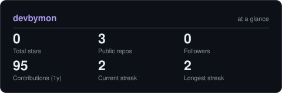
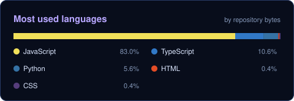

<!--
  PARA PERSONALIZAR:
  - Edita tus textos y enlaces en este README.
  - Edita los datos del banner en ROWS dentro de scripts/banner/generate.py.
  - Edita assets/skills.json, assets/langmix.json y assets/projects.json.
  - Regenera el banner con: .venv/bin/python scripts/banner/generate.py
-->

<!-- BANNER - terminal profile.sh --live (additive). Generated by scripts/banner/generate.py.
     ~0.7–0.8 MB each. Cache-bust with ?v=N after regenerating. -->
<picture>
  <source media="(prefers-color-scheme: dark)"  srcset="assets/banner-dark.v9.svg">
  <source media="(prefers-color-scheme: light)" srcset="assets/banner-light.v9.svg">
  
</picture>

 

<!-- NAME / TAGLINE - animated typing -->

 

 

---

## This is me :)

Hi, I'm **Monsserratt**, an Information Systems Engineer from Costa Rica 🇨🇷.
I combine software development, project management and leadership to build
technology initiatives that create a positive impact.

- 🎓 **President of Information Systems Engineering at ULACIT**: leading a community of 600+ students and coordinating academic, technology and career development initiatives.
- 📱 **Mobile Developer Intern at Element System**: building responsive Flutter applications, integrating RESTful APIs and collaborating through Scrum.
- 💻 Former **Information Technology Intern at Stryker**, where I contributed to knowledge management, digital learning and operational efficiency.
- 🚀 I enjoy working with **Python, Java, JavaScript, Dart, React and Flutter**.
- 🌱 Currently pursuing a **Licentiate Degree in Information Systems with an emphasis in Software Development**.
- 💬 Talk to me about **software development, mobile applications, project management and technology leadership**.

 

## my perfect stack`

<!-- Edita la lista después de ?i= con tus tecnologías. -->

---

## signals

<table>
<tr>
<td width="50%" align="center" valign="middle">

<!-- Self-rated radar - edit assets/skills.json, the workflow redraws it -->
<picture>
  <source media="(prefers-color-scheme: dark)"  srcset="assets/radar-dark.svg">
  <source media="(prefers-color-scheme: light)" srcset="assets/radar-light.svg">
  
</picture>

</td>
<td width="50%" align="center" valign="middle">

<!-- Hand-authored contract & language stack radar - edit assets/langmix.json -->
<picture>
  <source media="(prefers-color-scheme: dark)"  srcset="assets/radar-langs-dark.svg">
  <source media="(prefers-color-scheme: light)" srcset="assets/radar-langs-light.svg">
  
</picture>

</td>
</tr>
</table>

---

## Numbers matter? ohhh yes.

<!-- Generated by scripts/cards.py into this repo. Deliberately NOT
     github-readme-stats / streak-stats / github-profile-trophy: those are
     shared public instances that go down and take the whole section with them. -->
<picture>
  <source media="(prefers-color-scheme: dark)"  srcset="assets/card-stats-dark.svg">
  <source media="(prefers-color-scheme: light)" srcset="assets/card-stats-light.svg">
  
</picture>

 

<picture>
  <source media="(prefers-color-scheme: dark)"  srcset="assets/card-languages-dark.svg">
  <source media="(prefers-color-scheme: light)" srcset="assets/card-languages-light.svg">
  
</picture>

---

` Build with love · @devbymon `

