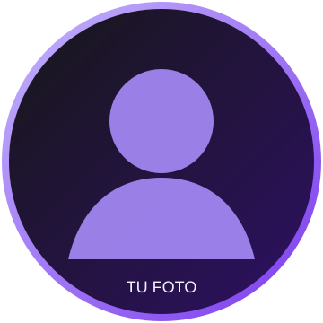

<!--
  GUÍA RÁPIDA
  1. Reemplaza los textos entre [CORCHETES].
  2. Agrega tu foto en assets/profile-photo.png.
  3. Cambia profile-placeholder.svg por profile-photo.png en la imagen de abajo.
  4. Actualiza tus enlaces y las tecnologías de tu stack.
-->

# Hola, soy [TU NOMBRE] 👋

 

<!-- Elimina las redes que no uses y reemplaza los enlaces. -->

  

---

## Sobre mí

Soy **[TU NOMBRE]**, [TU ROL, CARRERA O ESPECIALIDAD] de [TU PAÍS O CIUDAD].
[ESCRIBE AQUÍ DOS O TRES LÍNEAS SOBRE LO QUE HACES, LO QUE TE GUSTA CREAR Y EL IMPACTO QUE QUIERES GENERAR].

- 🔭 Actualmente trabajo en **[PROYECTO, EMPRESA O ÁREA]**.
- 🌱 Estoy aprendiendo **[TECNOLOGÍA O TEMA]**.
- 💡 Me interesa **[ÁREAS QUE TE APASIONAN]**.
- 🤝 Me gustaría colaborar en **[TIPO DE PROYECTOS]**.
- 💬 Puedes preguntarme sobre **[TEMAS QUE DOMINAS]**.
- ⚡ Dato curioso: **[ALGO SOBRE TI]**.

 

## Mi stack

<!--
  Busca los nombres disponibles en https://skillicons.dev
  y reemplaza la lista después de ?i=.
-->

---

## Mis estadísticas

<!-- Estas tarjetas ya apuntan a tu usuario de GitHub: devbymon. -->

---

Hecho con 💜 por [TU NOMBRE]

