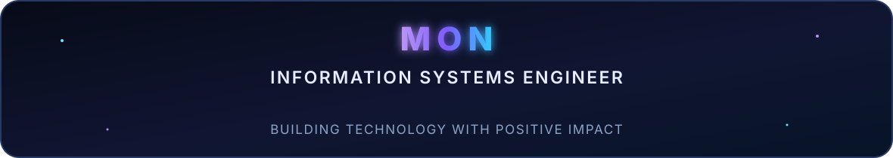
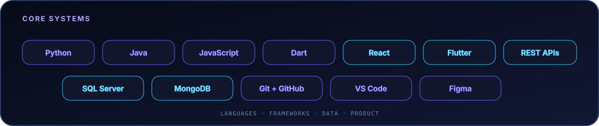

<!--
  PARA PERSONALIZAR:
  - Edita tus textos y enlaces en este README.
  - Edita los datos del banner en ROWS dentro de scripts/banner/generate.py.
  - Edita assets/skills.json, assets/langmix.json y assets/projects.json.
  - Regenera el banner con: .venv/bin/python scripts/banner/generate.py
-->

<!-- BANNER - terminal profile.sh --live (additive). Generated by scripts/banner/generate.py.
     ~0.7–0.8 MB each. Cache-bust with ?v=N after regenerating. -->
<picture>
  <source media="(prefers-color-scheme: dark)"  srcset="assets/banner-dark.v9.svg">
  <source media="(prefers-color-scheme: light)" srcset="assets/banner-light.v9.svg">
  
</picture>

 

<!-- Local, non-clickable identity panel. -->

 

<!-- Social cards are intentionally informational, not buttons. -->

  

<table>
<tr>
<td align="center"><code>● ONLINE</code></td>
<td align="center"></td>
<td align="center"><code>COSTA RICA · UTC-6</code></td>
</tr>
</table>

---

## 01 / This is me

<table>
<tr>
<td width="50%" valign="top">

### 👩🏽‍💻 Engineer

Information Systems Engineer focused on software development, product thinking and useful digital experiences.

</td>
<td width="50%" valign="top">

### ✦ Leadership

President of Information Systems Engineering at ULACIT, representing a community of 600+ students.

</td>
</tr>
<tr>
<td width="50%" valign="top">

### ◈ Building now

Mobile experiences with Flutter, reusable interfaces, REST APIs and collaborative Agile workflows.

</td>
<td width="50%" valign="top">

### ↗ Positive impact

Technology, project management and communication working together to create opportunities for people.

</td>
</tr>
</table>

 

## 02 / My perfect stack

<!-- Local and intentionally non-clickable. -->

---

## 03 / Signals

<table>
<tr>
<td width="50%" align="center" valign="middle">

<!-- Self-rated radar - edit assets/skills.json, the workflow redraws it -->
<picture>
  <source media="(prefers-color-scheme: dark)"  srcset="assets/radar-dark.svg">
  <source media="(prefers-color-scheme: light)" srcset="assets/radar-light.svg">
  
</picture>

</td>
<td width="50%" align="center" valign="middle">

<!-- Hand-authored development stack radar - edit assets/langmix.json -->
<picture>
  <source media="(prefers-color-scheme: dark)"  srcset="assets/radar-langs-dark.svg">
  <source media="(prefers-color-scheme: light)" srcset="assets/radar-langs-light.svg">
  
</picture>

</td>
</tr>
</table>

---

## 04 / Numbers matter? Oh yes.

<!-- Generated by scripts/cards.py into this repo. Deliberately NOT
     github-readme-stats / streak-stats / github-profile-trophy: those are
     shared public instances that go down and take the whole section with them. -->
<table>
<tr>
<td width="50%" align="center" valign="middle">

<picture>
  <source media="(prefers-color-scheme: dark)" srcset="assets/card-stats-dark.svg">
  <source media="(prefers-color-scheme: light)" srcset="assets/card-stats-light.svg">
  
</picture>

</td>
<td width="50%" align="center" valign="middle">

<picture>
  <source media="(prefers-color-scheme: dark)" srcset="assets/card-languages-dark.svg">
  <source media="(prefers-color-scheme: light)" srcset="assets/card-languages-light.svg">
  
</picture>

</td>
</tr>
</table>

---

` Build with love · @devbymon `

